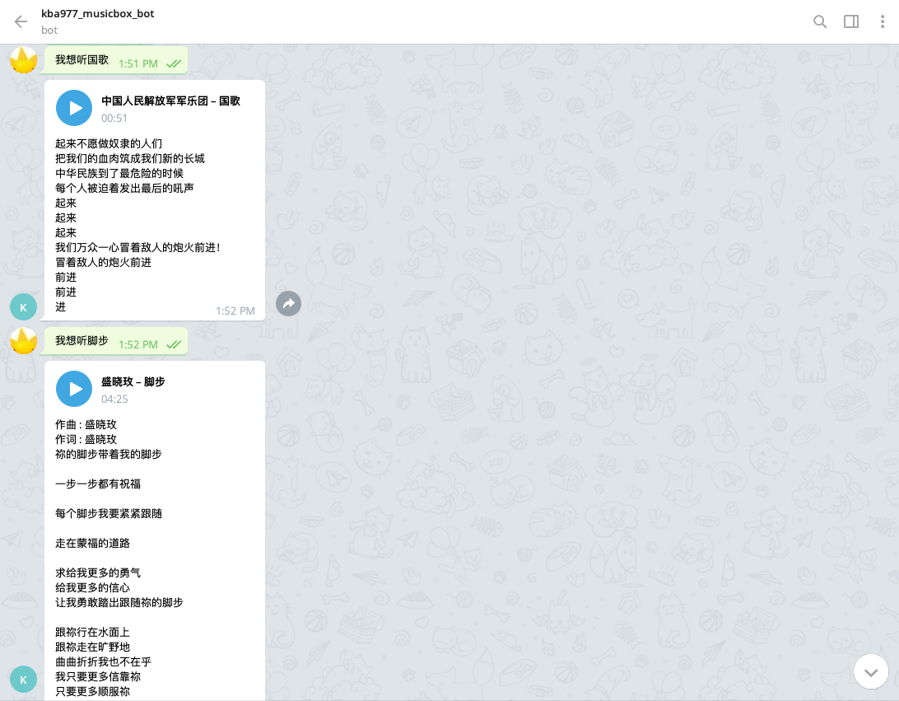

# Telegram 音乐盒子

在 Telegram 上搜索并下载网易云音乐。

## 使用

私聊或群聊里发送 `我想听歌名` 或 `/music 歌名`（群聊里也可以 `@bot 歌名`）：

1. bot 列出最多 8 首候选歌曲，🔒 标记的是 VIP / 付费歌曲；
2. 点击按钮选择后开始下载（私聊会显示进度条），发送带封面、歌词的 mp3；
3. 无法下载的歌曲会提示原因并附上歌词。

> 群聊里想直接用「我想听xxx」，需要在 @BotFather 中 `/setprivacy` → `Disable` 关闭隐私模式，然后把 bot 重新拉进群；否则只能用 `/music` 或 `@bot`。



## 特性

- 直接调用网易云官方接口，不依赖第三方音乐 API
- 同一首歌只下载上传一次，之后用 Telegram file_id 秒发（缓存存在 SQLite，重启不丢）
- 多人同时点同一首歌时合并为一次下载；限制同时下载数；每人同一时间只处理一个请求
- 自动遵守 Telegram 发消息频率限制，超限时排队重试
- 启动时自检网易云连通性，发现地区限制会在日志里提示，可通过 `NETEASE_PROXY` 配置代理

## 本地运行

需要 [uv](https://docs.astral.sh/uv/)：

```bash
cp .env.example .env        # 填入 TG_BOT_TOKEN
uv sync
uv run --env-file .env python -m musicbox
```

运行测试：

```bash
uv run pytest                        # 单元测试
NETEASE_LIVE=1 uv run pytest -m live # 访问真实网易云接口的连通性测试
uv run ruff check .
```

## 部署（Docker）

任意能跑 Docker 的 VPS 都可以，使用 polling 模式，不需要域名和 HTTPS：

```bash
git clone https://github.com/kba977/tg_musicbox.git && cd tg_musicbox
cp .env.example .env        # 填入 TG_BOT_TOKEN
docker compose up -d --build
docker compose logs -f      # 看到「网易云连通性检查通过」即可
```

更新：`git pull && docker compose up -d --build --force-recreate`

> 网易云对海外 IP 有地区限制。如果日志提示「当前 IP 可能被限制地区」，在 `.env` 里配置 `NETEASE_PROXY` 指向一个香港或国内的代理。
>
> 同一个 token 只能有一个实例在 polling，不要同时在本地和服务器上运行。

### 用家里的电脑做网易云代理（免费）

VPS 在海外时，可以用一台常开、能正常访问网易云的电脑，通过 SSH 反向隧道在 VPS 上开一个 SOCKS5 代理：

```bash
# 在家里的电脑上运行（建议用 launchd / systemd 常驻，断线自动重连）
ssh -N -o ExitOnForwardFailure=yes -o ServerAliveInterval=30 -R 127.0.0.1:1080 <vps>
```

VPS 上的配置：

```bash
echo 'NETEASE_PROXY=socks5://127.0.0.1:1080' >> .env
cat > docker-compose.override.yml <<'EOF'
services:
  musicbox:
    network_mode: host   # 容器才能访问宿主机 127.0.0.1 上的隧道端口
EOF
docker compose up -d --force-recreate
```

## 项目结构

```
musicbox/
├── __main__.py   # 入口：python -m musicbox
├── config.py     # 从环境变量读取配置
├── netease.py    # 网易云客户端：搜索、详情、歌词、下载
├── cache.py      # file_id 缓存（SQLite）、并发锁
└── bot.py        # Telegram 交互：点歌、选歌按钮、发送
tests/            # pytest 测试
```

## 限制

- 只有免费歌曲能下载，VIP / 付费 / 无版权的歌曲只能返回歌词
- Telegram 限制 bot 在同一个群每分钟约 20 条消息，高峰时点歌需要排队
- bot 上传文件上限 50MB
